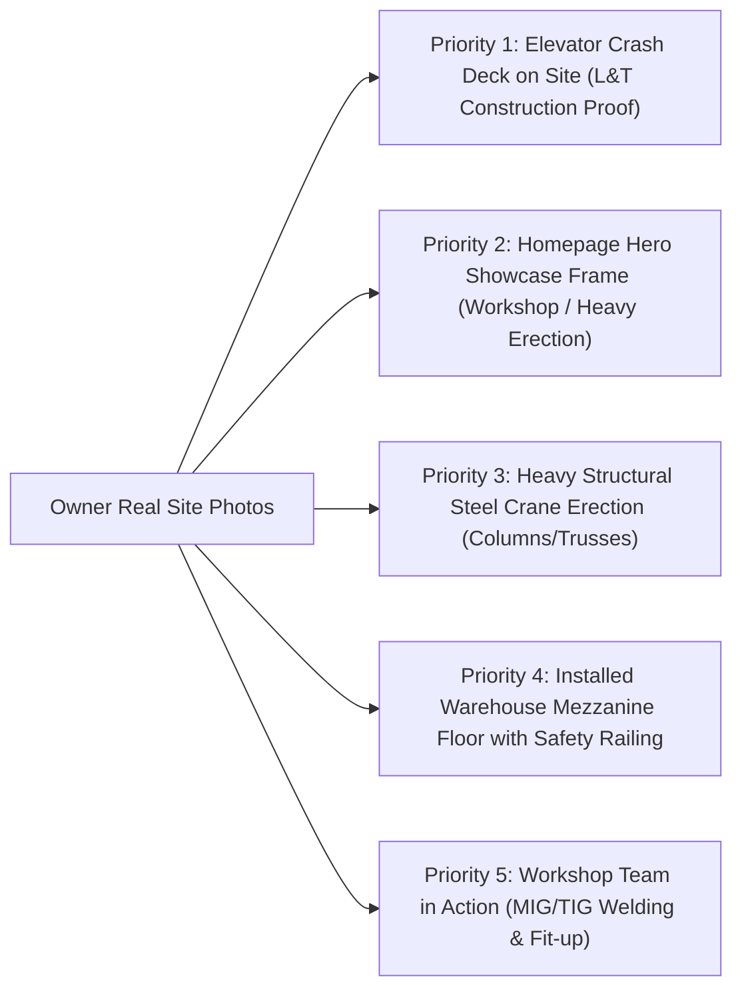

# Karali Fabrication — Visual Asset & Image Sourcing Roadmap

> **Document Status:** Planning & Procurement Specification (Phase 3D)  
> **Standard:** Zero Fabrication Policy (No misrepresenting stock or placeholders as Karali projects)  
> **Technical Constraint:** Strict CSP Compliance (`img-src 'self' data:` in `public/_headers`)

---

## 1. Current Visual Asset Baseline (Phase 3C Inventory)

In Phase 3C, **20 unique local SVG visual assets** (`~82 KB` total) were created under `public/images/` and documented in `docs/tooling/image-asset-manifest.md`.

* **1 Homepage Hero Visual:** `/images/hero/industrial-steel-fabrication-hero.svg` (`1280×800`).
* **5 Core Service Visuals:** `/images/services/<slug>.svg` (`800×500`, reused on service heroes, service cards, and related service cards).
* **10 Catalogue Schematic Visuals:** `/images/catalogue/cat-01-` to `cat-10-` (`640×400`).
* **3 Gallery Reference Slots:** `/images/gallery/gallery-01-` to `03-` (`800×500`).
* **1 Process Workflow Visual:** `/images/process/fabrication-workflow-diagram.svg` (`960×280`).

### Current Status & Honest Disclosures
Every single asset is currently categorized as an **illustrative technical schematic** or **reserved reference slot awaiting verified owner site photo**. This guarantees:
1. Complete legal and ethical safety (no false advertising or unverified project claims).
2. 100% CSP compliance with zero third-party image hosting dependencies.
3. Perfect responsive scaling and sub-second load times across mobile and desktop devices.

---

## 2. High-Impact Real Photography Priorities

While technical SVGs represent the engineering scope cleanly, **authentic photographs of Karali's actual workshop, machinery, and on-site erections are the #1 driver of contractor trust and B2B conversion**.

The following 5 visual locations have been identified where real photographs will produce the highest ROI:

1. **Priority 1: Elevator Crash Deck & Working Platform in an Actual High-Rise Shaft:**
   * **Why it matters:** Karali has verified commercial invoices and delivery challans for elevator shaft crash decks for major contractors (L&T Construction). Replacing the schematic SVG with a crisp, real photo of an installed crash deck immediately proves high-rise compliance capability.
   * **Target Placement:** `/services/lift-shaft-steelwork-crash-decks/` hero card and Homepage Gallery Slot `KF-REF-02`.
2. **Priority 2: Heavy Structural Steelwork On-Site Erection:**
   * **Why it matters:** Showing crane rigging, bolted splice connections, or heavy portal frames on an active MMR job site demonstrates capacity to handle large structural tonnage.
   * **Target Placement:** Homepage Hero `.hero-visual-frame` and `/services/structural-steel-fabrication/`.
3. **Priority 3: Completed Industrial Mezzanine Floor:**
   * **Why it matters:** Warehouse and plant managers want to see the rigidity of the steel columns, deck plating, and safety stair access in an actual facility.
   * **Target Placement:** `/services/industrial-sheds-mezzanines/` hero card and Homepage Gallery Slot `KF-REF-03`.
4. **Priority 4: Workshop Fabrication & Welding in Progress:**
   * **Why it matters:** Candid, well-lit photos of welders wearing safety PPE, section cutting on horizontal band saws, and jig fit-up prove that Karali operates a genuine fabrication workshop rather than acting as a broker.
   * **Target Placement:** Homepage `#capabilities` section and About modal/story.
5. **Priority 5: Finished Compound Gates & Fire Escape Staircases:**
   * **Why it matters:** Demonstrates quality of surface finishing, smooth weld grinding, and alignment on architectural access metalwork.
   * **Target Placement:** `/services/staircases-railings-gates/` and Catalogue item `cat-07`.

---

## 3. Owner Photography Shooting & Submission Protocol

To make it effortless for Karali's workshop team or site engineers to capture publication-grade photos using modern smartphones, provide them with this concise field checklist:

### Field Photography Checklist for Workshop & Site Staff:
* **Orientation & Aspect Ratio:** Shoot in **Landscape mode (horizontal)**, holding the phone steady with both hands. Aim for standard `16:10` or `16:9` framing.
* **Resolution:** Ensure camera settings are set to **High Resolution / Original Quality** (minimum `1920×1080` or higher; `12–48 MP` phone cameras are ideal).
* **Lighting:**
  * In the workshop: Turn on all overhead high-bay lighting. Avoid shooting directly into intense glare from open yard doors.
  * On site: Shoot in morning or late afternoon natural daylight. Avoid heavy backlight that turns structural steel into a dark silhouette.
* **Composition & Context:**
  * Show the scale: Include a worker, ladder, or column in the frame to illustrate physical proportion.
  * Step back for an establishing shot, then step forward for crisp connection close-ups (e.g. bolted gusset plate, clean weld fillet).
* **Privacy & Client Confidentiality:**
  * Do not capture confidential client architectural blueprints, proprietary manufacturing lines, or third-party workers' faces without clearance.
  * Ensure workers in the frame are wearing standard safety gear (hard hats, safety glasses/shields, safety boots).
* **Submission Channel:**
  * Send original uncompressed photos as **Documents on WhatsApp** or upload to a shared Google Drive folder (avoid standard WhatsApp compression which reduces image sharpness).

---

## 4. Commercial Licensing & Fallback Sourcing Matrix

If owner photographs for certain specialized categories take time to assemble, a hybrid approach of **licensed commercial photography** and **technical schematic illustrations** will maintain professional aesthetic standards without violating truth-in-advertising principles.

### Sourcing & Attribution Governance Rules:
1. **Zero Fabrication Policy:** If a commercial stock image is used, its caption or badge **must never claim** *"Completed project by Karali Fabrication"*. It must be honestly labeled *"Illustrative Project Reference"* or *"Technical Scope Photography"*.
2. **CSP Compliance:** Any purchased or open-licensed photograph must be downloaded, converted to optimized WebP format, and served locally from `/public/images/`. No direct hotlinking to external CDNs.
3. **Approved Commercial Stock Sources:**
   * Commercial Free-to-Use with Modification: Unsplash Commercial License, Pexels Commercial License (carefully filtered for realistic Indian/industrial contexts).
   * Premium Licensed (if owner budget permits): Adobe Stock or Shutterstock (standard commercial web license).

### Detailed Sourcing Matrix by Website Section

| Page & Placement | Current Asset | Preferred Source: Genuine Karali Photo | Fallback Plan: Commercial Stock / SVG | Draft Alt Text (Truthful Standard) |
| :--- | :--- | :--- | :--- | :--- |
| **Homepage Hero Showcase** (`index.html`) | `industrial-steel-fabrication-hero.svg` | Verified wide-angle photo of heavy structural steel portal frame or crane erection in MMR. | Keep custom vector hero illustration with arc-welding highlight. | `Industrial structural steel fabrication and on-site frame erection across Mumbai and Thane` |
| **Service 01: Structural Steel** | `structural-steel-fabrication.svg` | Completed column-beam grid or roof truss erection at an MMR industrial site. | Commercial stock of heavy steel beam fabrication in workshop, labeled *Illustrative Scope*. | `Heavy structural steel columns, beams, and roof truss assembly fabricated to client drawing` |
| **Service 02: Lift Shafts & Decks** | `lift-shaft-steelwork-crash-decks.svg` | **High Priority:** Actual photo of L&T / high-rise elevator shaft crash deck or divider beam assembly. | Keep custom technical schematic SVG showing crash deck tie-backs and shaft cage. | `Heavy-duty elevator shaft crash deck and structural steel divider platform installed in high-rise core` |
| **Service 03: Sheds & Mezzanines** | `industrial-sheds-mezzanines.svg` | Verified photo of completed factory shed roof trusses or installed warehouse mezzanine floor. | Commercial stock of modern industrial mezzanine floor with safety handrail (*Illustrative*). | `Industrial factory shed portal frames and heavy-duty structural steel mezzanine floor platform` |
| **Service 04: Stairs, Railings & Gates** | `staircases-railings-gates.svg` | Finished commercial fire escape tower, industrial steel staircase, or heavy automated society gate. | Commercial stock of exterior steel spiral or straight-flight staircase with safety handrails. | `Commercial steel fire escape staircase, safety handrails, and heavy compound sliding entrance gate` |
| **Service 05: Custom Fabrication** | `custom-metal-fabrication.svg` | Close-up photo of drilled MS base plates with anchor gussets, equipment skids, or site welding bead. | Keep custom technical schematic SVG showing drilled plates and skid frame. | `Custom drilled MS base plates, welded stiffener brackets, equipment skids, and on-site structural welding` |
| **Gallery Slot 01** (`KF-REF-01`) | `gallery-01-structural-frame.svg` | Heavy structural steel column-beam frame during site erection. | Keep SVG labeled *Illustrative Placeholder · Awaiting Owner Site Photo*. | `Structural steel beam, column, and roof truss erection project reference slot` |
| **Gallery Slot 02** (`KF-REF-02`) | `gallery-02-lift-shaft-deck.svg` | High-rise elevator shaft divider beams and temporary working platform. | Keep SVG labeled *Illustrative Placeholder · Awaiting Owner Site Photo*. | `High-rise elevator shaft steel cage, divider beams, and heavy crash deck reference slot` |
| **Gallery Slot 03** (`KF-REF-03`) | `gallery-03-shed-mezzanine-access.svg` | Industrial shed interior with mezzanine floor and integrated access staircase. | Keep SVG labeled *Illustrative Placeholder · Awaiting Owner Site Photo*. | `Industrial factory shed portal trusses, mezzanine floor grid, and steel access staircase slot` |
| **Process Diagram** (`#capabilities`) | `fabrication-workflow-diagram.svg` | **Keep as SVG vector diagram** (clean, crisp, and self-explanatory on all DPI screens). | N/A (SVG is optimal for multi-step process workflows). | `Three-step fabrication workflow: Drawing review, workshop cutting and welding, and on-site MMR erection` |

---

## 5. Image Optimization & Build Pipeline

When genuine photographs are delivered by the owner:
1. **Naming Convention:** Descriptive, lowercase, hyphenated filenames indicating service and project type (e.g. `karali-lift-shaft-crash-deck-highrise-mumbai.webp`).
2. **Format & Sizing:**
   * Convert high-res source files to **WebP** (`q=82` for photographs, balancing visual fidelity with sub-100KB file sizes).
   * Provide explicit `width` and `height` attributes in HTML markup to maintain **Cumulative Layout Shift (CLS) = 0**.
   * Desktop Hero & Primary Cards: `1280×800` or `800×500`.
   * Catalogue & Secondary Cards: `640×400`.
3. **Loading Strategy:**
   * Above-the-fold Hero Showcase: `fetchpriority="high"`, `decoding="async"`, NO `loading="lazy"`.
   * Below-the-fold Cards & Gallery: `loading="lazy"`, `decoding="async"`.
