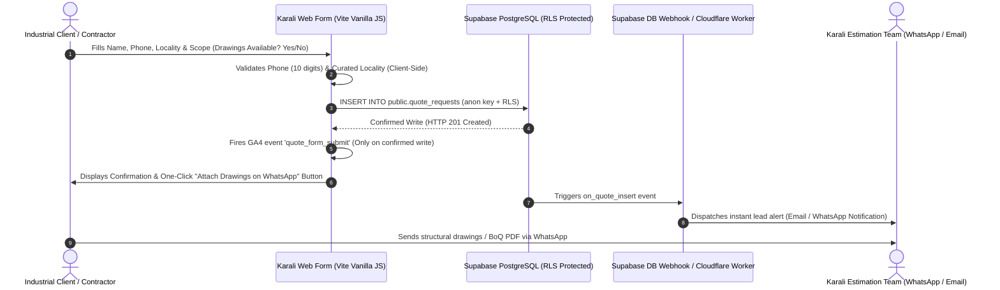

# Karali Fabrication — Lead-Generation Architecture & Conversion Tracking Roadmap

> **Document Status:** Technical Architecture & Implementation Specification (Phase 3D / Pre-Phase 4)  
> **Security Baseline:** Zero Service-Role Keys in Client Bundle; Strict Row Level Security (RLS)  
> **Conversion Priority:** 1. Direct Phone (`tel:`) -> 2. Contextual WhatsApp (`wa.me`) -> 3. Low-Friction Quote Form

---

## 1. Executive Strategy & Current Conversion Baseline

Karali Fabrication caters primarily to **civil contractors, structural engineers, factory managers, and housing society decision-makers**. 

In industrial fabrication, procurement decisions operate differently from standard consumer e-commerce:
* **The Prime Decision Trigger is Drawing / BoQ Review:** Industrial buyers almost never buy off a shopping cart; they have architectural blueprints, CAD drawings, structural section schedules, or a tender Bill of Quantities (BoQ) and need an itemized fabrication quote based on tonnage and site logistics.
* **Urgency & Mobility:** Site supervisors and contractors frequently browse from mobile devices while standing on an active construction site in Rabale, Taloja, or Thane. They demand an immediate phone line or instant WhatsApp chat to transmit drawings.

### Current Baseline Channels (Phase 3C):
1. **Direct Phone Call (`tel:+917977591792`):** Accessible in the header, mobile sticky drawer, hero section, and enquiry block. Operates 100% independently of JavaScript, database availability, or internet connectivity.
2. **Contextual WhatsApp Links (`https://wa.me/917977591792?text=...`):** Configured with pre-filled, service-specific and catalogue-item-specific enquiry prompts (e.g. *"Hello Karali Fabrication, I have a requirement for Lift Shaft Steelwork, Crash Decks & Platforms..."*).
3. **Locality Selection Form (`#locality-form`):** Currently writes a test locality string to the Supabase table `public.location_test_submissions`.

---

## 2. Proposed Phase 4 Quote Request Form Architecture

To upgrade the website from the single-field locality test into a commercial-grade quote generation engine, we propose the following **low-friction, high-conversion architecture**:



### Form Fields & Client-Side UX:
* **Step 1: Contact Details:**
  * Full Name / Company Name (Required, text)
  * Mobile Phone Number (Required, 10-digit Indian format `[6-9]\d{9}`)
  * Project Locality (Searchable combobox connected to our 57 curated MMR localities)
* **Step 2: Technical Scope:**
  * Fabrication Service Pillar (Dropdown pre-selected based on current page URL)
  * Approximate Scope / Tonnage / Dimensions (Optional textarea: e.g., *"12m x 25m factory shed with 5m eave height"*)
  * *Do you have structural drawings or BoQ?* (Radio: Yes / In Progress / Site Visit Needed)
* **The "Zero-Storage" Drawing Hand-off Bridge:**
  * Instead of building complex, high-risk unauthenticated file upload storage into Supabase (which introduces storage quota costs, malware risks, and bucket permission vulnerabilities), the form concludes with a streamlined bridge:
  * Upon form submission, the user receives an instant confirmation on screen with a high-visibility button:  
    👉 **"Send Drawings & BoQ to Engineering on WhatsApp (+91 79775 91792)"** (with the lead ID pre-encoded in the message text).
  * This matches contractor habits perfectly while eliminating web server storage overhead.

---

## 3. Database Schema & Supabase RLS Security Model

> [!CAUTION]
> **Credential Security Standard:**  
> Only `VITE_SUPABASE_URL` and `VITE_SUPABASE_ANON_KEY` may be present in the frontend bundle.  
> **Never** expose the `service_role` key in frontend code, git commits, or client-side storage.

### Draft PostgreSQL Migration (`supabase/migrations/20261027000000_create_quote_requests.sql`):
```sql
-- Create table for structured industrial quote requests
CREATE TABLE IF NOT EXISTS public.quote_requests (
    id UUID PRIMARY KEY DEFAULT gen_random_uuid(),
    created_at TIMESTAMPTZ NOT NULL DEFAULT timezone('utc'::text, now()),
    client_name TEXT NOT NULL,
    phone_number TEXT NOT NULL,
    locality TEXT NOT NULL,
    service_slug TEXT NOT NULL,
    project_scope TEXT,
    has_drawings BOOLEAN NOT NULL DEFAULT false,
    status TEXT NOT NULL DEFAULT 'new' CHECK (status IN ('new', 'contacted', 'quoted', 'closed')),
    source_url TEXT,
    user_agent TEXT,
    
    -- Constraint validation
    CONSTRAINT valid_client_name CHECK (char_length(trim(client_name)) BETWEEN 2 AND 100),
    CONSTRAINT valid_phone_number CHECK (phone_number ~ '^[6-9][0-9]{9}$'),
    CONSTRAINT valid_locality CHECK (char_length(trim(locality)) BETWEEN 2 AND 80)
);

-- Enable & Force Row Level Security (RLS)
ALTER TABLE public.quote_requests ENABLE ROW LEVEL SECURITY;
ALTER TABLE public.quote_requests FORCE ROW LEVEL SECURITY;

-- Revoke default broad permissions
REVOKE ALL ON TABLE public.quote_requests FROM public, anon, authenticated;

-- Grant minimal insert-only permissions to anonymous visitors
GRANT INSERT (client_name, phone_number, locality, service_slug, project_scope, has_drawings, source_url)
    ON TABLE public.quote_requests
    TO anon;

-- RLS Policy: Anyone can insert their quote request
CREATE POLICY "Allow public anon quote request submissions"
    ON public.quote_requests
    FOR INSERT
    TO anon
    WITH CHECK (true);

-- Explicitly deny SELECT, UPDATE, DELETE to anon users (prevents data harvesting)
CREATE POLICY "Deny anon reads"
    ON public.quote_requests
    FOR SELECT
    TO anon
    USING (false);
```

---

## 4. Conversion Event Measurement Specification

To track marketing ROI across SEO, Google Business Profile, and referral traffic without sacrificing performance, we define the following standard event measurement schema:

### Event Definitions & Triggers
| Event Name | Triggering User Action | Data Payload | Firing Rule |
| :--- | :--- | :--- | :--- |
| `click_to_call` | User clicks any `tel:+917977591792` link | `{ placement: 'header' \| 'hero' \| 'footer' \| 'enquiry' }` | Immediately on click / tap. |
| `click_to_whatsapp` | User clicks any `wa.me` CTA link | `{ service: '<service-slug>', placement: 'card' \| 'hero' }` | Immediately on click / tap. |
| `locality_test_submit`| User submits the Coming-Soon locality form | `{ locality: '<locality-name>' }` | **Strict Rule:** Fire ONLY when Supabase returns HTTP 201 Created (`error === null`). |
| `quote_form_submit` | User submits the full Phase 4 quote form | `{ service: '<slug>', locality: '<name>', has_drawings: true\|false }` | **Strict Rule:** Fire ONLY after database write is confirmed. Never on button submit click. |

### Technical Implementation Pattern:
```javascript
// src/lib/analytics.js
export function trackEvent(eventName, eventParams = {}) {
  // Check if Google Analytics / gtag exists
  if (typeof window.gtag === 'function') {
    window.gtag('event', eventName, eventParams);
  }
  
  // Custom console dispatch for testing & local verification
  if (import.meta.env.DEV) {
    console.info(`[Analytics Event] ${eventName}:`, eventParams);
  }
}
```

---

## 5. Instant Lead Notification Pipeline (Owner Alerting)

A contractor submitting an enquiry expects a callback or WhatsApp acknowledgement within 15 to 30 minutes. 

To bridge database inserts to the owner's mobile device without running an expensive 24/7 Node.js backend server:
1. **Option A: Supabase Database Webhook + Cloudflare Worker:**
   * Supabase automatically fires an HTTP POST webhook on `INSERT` to `public.quote_requests`.
   * A lightweight Cloudflare Worker receives the payload and dispatches a formatted notification via the **Telegram Bot API** or **WhatsApp Business Cloud API** directly to the owner's phone (`+91 79775 91792`).
2. **Option B: Transactional Email via Resend:**
   * Cloudflare Worker sends an immediate HTML notification to the owner's email with client details and project scope.

---

## 6. Security & RLS Pre-Implementation Checklist

Before Phase 4 database migration is executed in the live Supabase project:
- [ ] Explicit owner approval granted to create `public.quote_requests`.
- [ ] RLS is confirmed active with `FORCE ROW LEVEL SECURITY`.
- [ ] Anonymous users (`anon`) have `INSERT` permission only; `SELECT` is strictly blocked (`USING (false)`).
- [ ] Rate-limiting configured at Cloudflare Pages edge (e.g. maximum 5 submissions per IP per hour) to prevent automated form spam.
- [ ] Phone regex validation constraint tested against valid and invalid numbers.
- [ ] Secret scan passes: verify zero service-role keys in repo or client bundle.
