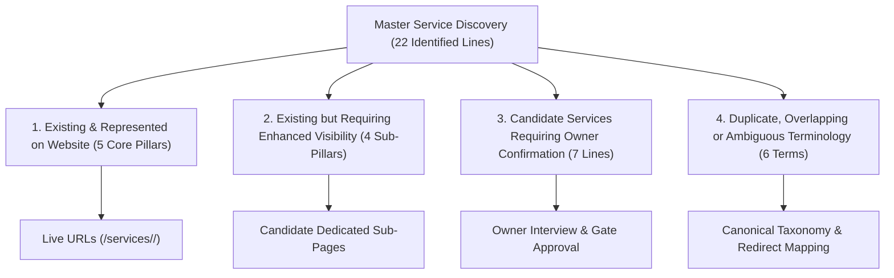
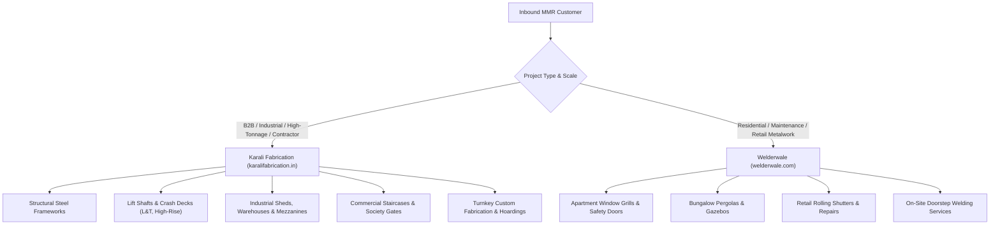

# Karali Fabrication — Master Service Inventory & Capability Assessment

> **Document Status:** Planning & Strategic Decision Matrix (Phase 3D)  
> **Last Updated:** 2026-10-26  
> **Author:** Antigravity AI Engineering & SEO Architecture Team  
> **Classification Framework:** Verified Existing, Under-Represented, Candidate (Pending Owner Approval), and Duplicate/Overlapping.

---

## 1. Executive Summary & Strategic Context

The business objective of Karali Fabrication (`https://karalifabrication.in`) is to represent **every fabrication and metalworking service that Karali genuinely executes**, without omitting profitable high-intent revenue streams or confusing commercial positioning.

Historically, the business has operated with two market touchpoints:
1. **Karali Fabrication:** High-tonnage, B2B structural steel, industrial sheds, elevator crash decks, and contractor-facing infrastructure across Mumbai, Thane, and Navi Mumbai (MMR).
2. **Welderwale (`welderwale.com`):** Architectural, commercial, and residential fabrication services (gates, grills, staircases, pergolas, shutters, farm sheds, and on-site welding repairs).

This inventory unifies all service lines identified across the existing Karali website, the 10-item product catalogue, the live Welderwale platform, and MMR industrial fabrication benchmarks into a single master decision matrix.

---

## 2. Service Classification & Decision Matrix

Each identified service is classified into one of four standard statuses:
* **Category 1: Existing & Represented:** Live dedicated service page and corresponding catalogue entries exist on `karalifabrication.in`.
* **Category 2: Existing but Under-Represented:** Currently bundled as a sub-bullet or generic catalogue item; high search intent and margin justify a dedicated service page or prominent hub.
* **Category 3: Candidate Service (Pending Owner Confirmation):** Present on Welderwale or competitor audits, but requires explicit confirmation of workshop tooling, site crew, and business preference before publishing on Karali Fabrication.
* **Category 4: Duplicate, Overlapping or Ambiguous:** Inconsistent naming across past specifications that must be consolidated into clean canonical terminology.

| # | Service Name | Discovered Source | Classification | Target Audience | Est. Transaction Value | Strategic Fit for Karali | Owner Confirmation Required? |
| :-: | :--- | :--- | :-: | :--- | :--- | :--- | :-: |
| **01** | **Structural Steel Fabrication** | Karali (Live), Welderwale | **Cat 1 (Live)** | Civil Contractors, Industrial Plants, Developers | High (₹5L – ₹50L+) | **Core Pillar** (Primary business identity) | No (Already Live) |
| **02** | **Lift Shaft Steelwork, Crash Decks & Platforms** | Karali (Live), Welderwale | **Cat 1 (Live)** | High-Rise Builders, Elevator OEMs, Contractors | High (₹2L – ₹25L+) | **Core Pillar** (Unique competitive differentiator) | No (Already Live) |
| **03** | **Industrial Sheds & Mezzanines** | Karali (Live), Welderwale | **Cat 1 (Live)** | Factory Owners, Warehouses, Logistics Hubs | High (₹3L – ₹40L+) | **Core Pillar** (High volume in MIDC zones) | No (Already Live) |
| **04** | **Staircases, Railings & Gates** | Karali (Live), Welderwale | **Cat 1 (Live)** | Commercial Fit-outs, Housing Societies, Villas | Mid (₹50k – ₹10L) | **Core Pillar** (Broad architectural demand) | No (Already Live) |
| **05** | **Custom Metal Fabrication & Site Welding** | Karali (Live), Welderwale | **Cat 1 (Live)** | General Contractors, Mechanical Engineers | Mid (₹25k – ₹5L) | **Core Pillar** (Flexible jobbing & site welding) | No (Already Live) |
| **06** | **Heavy Industrial Mezzanine Floors** | Karali (`#3` Sub-scope), Welderwale | **Cat 2 (Under-rep)** | Warehouses, Manufacturing Units, Logistics | High (₹2L – ₹20L) | High (Separate high-intent B2B search keyword) | No (Scope confirmed, page split optional) |
| **07** | **Elevator Crash Decks & Safety Working Platforms** | Karali (`#2` Sub-scope), Welderwale | **Cat 2 (Under-rep)** | Civil Contractors (e.g. L&T), High-Rise Builders | High (₹1L – ₹15L) | High (Confirmed by actual project quotations) | No (Scope confirmed by L&T invoices) |
| **08** | **Industrial & Society Sliding/Motorized Gates** | Karali (`#4` Sub-scope), Welderwale | **Cat 2 (Under-rep)** | Factories, Housing Societies, Commercial Malls | Mid (₹75k – ₹8L) | High (Commercial & society gate automation) | No (Scope confirmed in catalogue) |
| **09** | **Fire Escape & Spiral Steel Staircases** | Karali (`#4` Sub-scope), Welderwale | **Cat 2 (Under-rep)** | High-Rise Towers, Commercial Buildings, Factories | Mid–High (₹1L – ₹12L) | High (Municipal fire-safety compliance focus) | No (Scope confirmed in catalogue) |
| **10** | **Garden Pergolas & Metal Gazebos** | Welderwale (`slug: garden-pergola`) | **Cat 3 (Candidate)** | Villas, Penthouses, Rooftop Lounges, Architects | Mid (₹1L – ₹8L) | Medium (Architectural residential/hospitality) | **Yes (Confirm margin & crew availability)** |
| **11** | **Metal / Steel Furniture & Pallet Racking** | Welderwale (`slug: metal-furniture`) | **Cat 3 (Candidate)** | Warehouse Managers (Racks), Restaurants (Furniture) | Low–Mid (₹20k – ₹5L) | Low–Med (Industrial racking yes; home furniture no) | **Yes (Confirm focus on industrial racks vs retail)** |
| **12** | **Roofing Sheets Installation & Cladding** | Welderwale (`slug: roofing-sheets`) | **Cat 3 (Candidate)** | Industrial Sheds, Warehouses, Terrace Extensions | Mid (₹50k – ₹10L) | High (Natural complement to shed trusses) | **Yes (Confirm whether sheet supply/install is offered)** |
| **13** | **Rolling Shutters (Manual & Motorized)** | Welderwale (`slug: shutter`) | **Cat 3 (Candidate)** | Retail Shops, Warehouse Loading Bays, Garages | Mid (₹30k – ₹5L) | Medium (High search volume, competitive market) | **Yes (Confirm shutter manufacturing vs outsourcing)** |
| **14** | **Security & Window Grills (Housing Society / High-Rise)** | Welderwale (`slug: window-grill`) | **Cat 3 (Candidate)** | Residential Societies, High-Rise Apartments | Low–Mid (₹15k – ₹3L) | Low–Med (High volume, lower ticket; bulk society jobs fit) | **Yes (Confirm if residential retail jobs are desired)** |
| **15** | **Animal Farm Sheds (Dairy / Poultry / Goat)** | Welderwale (`slug: animal-farm-sheds`) | **Cat 3 (Candidate)** | Agri-business, Cattle Farms (Tabela), Rural Outskirts | Mid–High (₹2L – ₹15L) | Medium (Strong in Thane outskirts: Kalyan, Bhiwandi) | **Yes (Confirm willingness to travel outside MMR core)** |
| **16** | **Unipole Structures & Advertising Hoardings** | Welderwale (`slug: unipole-structure`) | **Cat 3 (Candidate)** | Outdoor Media Agencies, Highway Advertisers | High (₹5L – ₹30L) | High (Heavy structural steel, high engineering value) | **Yes (Confirm equipment & structural certification readiness)** |
| **17** | *"Structural Fabrication"* | Welderwale (`slug: structural-fabrication`) | **Cat 4 (Duplicate)** | — | — | Consolidated into `#01 Structural Steel Fabrication` | Terminology cleanup |
| **18** | *"Metal Sheds"* | Welderwale (`slug: metal-sheds`) | **Cat 4 (Duplicate)** | — | — | Consolidated into `#03 Industrial Sheds & Mezzanines` | Terminology cleanup |
| **19** | *"Metal Railing"* | Welderwale (`slug: metal-railing`) | **Cat 4 (Duplicate)** | — | — | Consolidated into `#04 Staircases, Railings & Gates` | Terminology cleanup |
| **20** | *"Staircase"* | Welderwale (`slug: staircase`) | **Cat 4 (Duplicate)** | — | — | Consolidated into `#04 Staircases, Railings & Gates` | Terminology cleanup |
| **21** | *"Custom Metal Frames & Installation"* | Welderwale (`slug: custom-metal-frames`) | **Cat 4 (Duplicate)** | — | — | Consolidated into `#05 Custom Metal Fabrication` | Terminology cleanup |
| **22** | *"Doorstep Welding & Repair"* | Welderwale | **Cat 4 (Unclear)** | Homeowners, Society Maintenance | Low (₹500 – ₹5k) | Very Low (Risks diluting Karali B2B industrial brand) | **Yes (Recommend keeping on Welderwale or separate)** |

---

## 3. Deep-Dive Assessment of Candidate Services (Category 3)

The user specifically requested an assessment of the 7 candidate services from prior research. Below is the technical, operational, and commercial viability assessment for each:

### 3.1 Pergolas & Gazebos (`garden-pergola`)
* **Service Definition:** Architectural steel/MS hollow pipe pergola frameworks, rooftop gazebo canopies, glass/polycarbonate roofing, and louvered shade structures.
* **Commercial Intent:** Luxury residential (villas, penthouses in Bandra, Juhu, Worli, Thane Ghodbunder), outdoor cafes, and rooftop dining spaces.
* **Ticket Size:** ₹1,00,000 to ₹8,00,000.
* **Production Requirements:** Precision cutting, seamless TIG/MIG welding, anti-corrosive PU coating, glass/polycarbonate mounting hardware.
* **Recommendation:** **Retain as an Architectural Catalogue Item or Secondary Service.** Do not make it a primary homepage pillar to preserve Karali's industrial engineering authority, but include it under an "Architectural Metalwork" section or in `/catalogue/` to capture high-margin luxury enquiries.
* **Owner Question:** *Does Karali wish to quote on residential rooftop pergolas and outdoor cafes, or remain exclusively focused on industrial and commercial steelwork?*

### 3.2 Metal / Steel Furniture & Racking (`metal-furniture`)
* **Service Definition:** Welded steel tables, heavy workbench tables, warehouse pallet racking systems, industrial storage racks, and minimalist MS frames.
* **Commercial Intent:** Industrial warehouses, logistics hubs (Bhiwandi, Taloja), commercial offices, and commercial kitchens.
* **Ticket Size:** ₹25,000 (single items) to ₹15,00,000 (complete warehouse racking fit-outs).
* **Production Requirements:** Sheet shearing, press brake bending, precision hole punching, powder coating.
* **Recommendation:** **Refocus strictly on Industrial Racking & Heavy Workbenches.** Reject residential consumer furniture (beds, stools, flower pot stands) which carries high customer-support overhead and low margin. Position as *Heavy-Duty Storage Racks & Industrial Workstations* in `/catalogue/`.
* **Owner Question:** *Should Karali offer warehouse pallet racking and heavy industrial workbenches, while excluding domestic furniture?*

### 3.3 Roofing Sheets Installation & Wall Cladding (`roofing-sheets`)
* **Service Definition:** Corrugated PPGI / Galvalume color-coated sheet installation, polycarbonate daylight panels, insulated sandwich panels, and gutter/downspout fabrication.
* **Commercial Intent:** Factory owners, warehouse operators, terrace shed extensions, industrial re-roofing.
* **Ticket Size:** ₹75,000 to ₹12,00,000.
* **Production Requirements:** Erection rigging, self-drilling fastener tooling, metal flashing bending, waterproofing flashing.
* **Recommendation:** **Strong Candidate for Dedicated Sub-Service or Inclusion in Industrial Sheds.** Industrial shed clients almost universally demand turnkey structure + sheeting packages. Karali currently lists "Purlins & Sheeting Support" under Sheds; expanding this into explicit roofing sheet replacement and installation addresses high search intent in industrial zones like Turbhe, Rabale, and Wagle Estate.
* **Owner Question:** *Does Karali supply and install the roofing sheets directly as a turnkey contractor, or only fabricate the supporting steel trusses and purlins?*

### 3.4 Rolling Shutters (`shutter`)
* **Service Definition:** Manual gear-operated and motorized heavy-gauge steel rolling shutters, perforated shopfront shutters, and industrial warehouse loading bay shutters.
* **Commercial Intent:** Retail shops, warehouse loading bays, commercial garages, factory gates.
* **Ticket Size:** ₹35,000 to ₹5,00,000.
* **Production Requirements:** Cold-rolled slat interlock assembly, spring barrel winding, guide rail welding, motor/switchgear wiring.
* **Recommendation:** **Candidate for Catalogue / Secondary Service.** While rolling shutters have high search volume, the market is competitive with specialized shutter vendors. Recommend including *Industrial & Commercial Rolling Shutters* as a catalogue item first; only create a dedicated landing page if Karali manufactures them in-house rather than subcontracting.
* **Owner Question:** *Does Karali manufacture rolling shutters in-house with dedicated slat machines, or are shutter installations outsourced to specialist vendors?*

### 3.5 Security & Window Grills (`window-grill`)
* **Service Definition:** MS/SS window safety grills, box grills with planter trays, high-rise safety balcony grills, and society safety doors.
* **Commercial Intent:** Housing societies, residential flats, redevelopment projects, schools, hospitals.
* **Ticket Size:** ₹15,000 (individual flat) to ₹8,00,000 (bulk housing society facade contract).
* **Production Requirements:** Repetitive bar cutting, jig welding, grinding, primer application.
* **Recommendation:** **Restrict to Bulk Housing Society & Commercial Contracts.** Discourage single-window residential retail calls, which consume estimating time for low ticket value. Position on the website under "Housing Society Architectural Metalwork" with a minimum order threshold (e.g. building-wide or floor-wide contracts).
* **Owner Question:** *Does Karali want to take on individual apartment window grill jobs, or only bulk contracts for housing societies and builders?*

### 3.6 Animal Farm Sheds (`animal-farm-sheds`)
* **Service Definition:** Ventilated structural steel sheds for cattle dairy farms (tabelas), poultry farms, and goat farming, featuring corrosion-resistant treatments and high natural ventilation.
* **Commercial Intent:** Dairy farmers, agricultural entrepreneurs, rural farm owners in Kalyan, Bhiwandi, Vasai, Virar, Panvel outskirts.
* **Ticket Size:** ₹3,00,000 to ₹25,00,000.
* **Production Requirements:** Portal frame welding, hot-dip galvanizing or heavy epoxy coating (to resist ammonia vapor), corrugated roofing.
* **Recommendation:** **Niche High-Intent Landing Page (P2 Priority).** There is significant agricultural/dairy activity in the outer MMR belt (Thane rural, Palghar, Raigad) with very few professional steel fabricators running modern websites. It provides high-ticket work without competing directly with Mumbai urban fabricators.
* **Owner Question:** *Is Karali actively interested in taking on cattle dairy and poultry farm shed projects in Bhiwandi, Kalyan rural, and Panvel outskirts?*

### 3.7 Unipole Structures & Advertising Hoardings (`unipole-structure`)
* **Service Definition:** Large-format outdoor advertising unipoles, highway billboard support structures, rooftop hoardings, and toll plaza gantry frameworks.
* **Commercial Intent:** Out-Of-Home (OOH) media companies, municipal advertising concessionaires, commercial real estate developers.
* **Ticket Size:** ₹5,00,000 to ₹35,00,000+.
* **Production Requirements:** Heavy-wall cylindrical pipe welding (350mm to 750mm diameter), heavy base flange welding, anchor cage fabrication, structural engineer stability vetting, crane erection.
* **Recommendation:** **High-Value B2B Addition to Structural Steel.** Unipoles are pure heavy structural steel fabrication. They require significant engineering credibility and deliver high margins. This directly elevates Karali's industrial profile.
* **Owner Question:** *Does Karali possess the welding and handling equipment required for heavy pipe unipole columns (e.g., 400mm+ diameter pipes and heavy crane rigging)?*

---

## 4. Brand Architecture Strategy: Karali Fabrication vs. Welderwale

The relationship between **Karali Fabrication** and **Welderwale** must be clearly defined to prevent brand dilution, cannibalization, or user confusion:

### Strategic Recommendations:
1. **Karali Fabrication as the Master Commercial Brand:**
   * Keep `karalifabrication.in` strictly focused on high-ticket B2B, industrial, architectural, and contractor projects.
   * Do not display low-ticket retail items ("₹500 door hinge welding", "flower pot stands", "individual window grills") on Karali's primary navigation.
2. **Representing High-Value Architectural Work on Karali:**
   * High-value architectural lines (pergolas, society gates, fire escapes, mezzanine floors, unipoles) *should* be represented on Karali under dedicated professional headings.
3. **Cross-Brand Routing & Referral:**
   * If a customer lands on Karali seeking small residential doorstep repairs, provide an honest referral or routing to Welderwale.
   * If a customer lands on Welderwale with a 50-tonne structural steel requirement, route them directly to Karali Fabrication.
