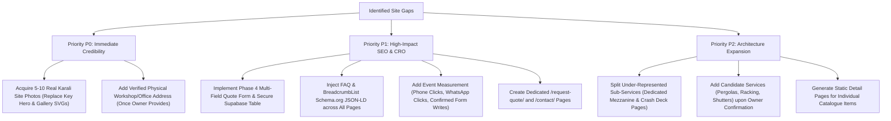

# Karali Fabrication — Website Gap Audit & Current State Review

> **Document Status:** Comprehensive Audit (Phase 3D)  
> **Audited URL Baseline:** `https://karalifabrication.in` (Branch `feature/coming-soon`)  
> **Testing Baseline:** 36/36 Vitest Unit Tests Passed; 22/22 Playwright E2E Tests Passed

---

## 1. Current State Overview & Architectural Strengths

The Karali Fabrication website has completed Phases 1 through 3C, establishing a solid, modern, and verified foundation:

* **Technology Stack:** Vite 8.3.4 + Vanilla JavaScript (ES Modules) + Semantic HTML5 + Custom CSS Tokens (`src/style.css`).
* **Hosting & Security:** Cloudflare Pages with strict HTTP headers (`public/_headers` enforces CSP `img-src 'self' data:`, `frame-ancestors 'none'`, `X-Content-Type-Options: nosniff`).
* **Multi-Page Architecture:** 7 fully pre-rendered static HTML entry points:
  1. `/` (Homepage)
  2. `/services/structural-steel-fabrication/`
  3. `/services/lift-shaft-steelwork-crash-decks/`
  4. `/services/industrial-sheds-mezzanines/`
  5. `/services/staircases-railings-gates/`
  6. `/services/custom-metal-fabrication/`
  7. `/catalogue/` (Interactive 10-item searchable catalogue)
* **Design System & Typography:** Barlow Condensed (Headings) + Inter (Body) via self-hosted `@fontsource` packages; industrial color palette (`#1F3C88` navy, `#F5A623` safety orange, `#07122b` dark backdrop).
* **Local Targeting:** 57 verified MMR localities in `src/data/localities.js` with client-side accessible combobox (`#locality-form`).
* **Direct CTAs:** Guaranteed zero-JS phone (`tel:+917977591792`) and contextual WhatsApp (`https://wa.me/917977591792?text=...`) links across all headers, cards, and footers.
* **Truthfulness Standard:** Zero fabricated claims, zero fake client testimonials, zero invented addresses, and honest placeholder disclosures across all 20 local SVG assets.

---

## 2. Comprehensive Gap Analysis Matrix

The audit identified specific gaps across 5 architectural areas that must be addressed to maximize search visibility, user trust, and enquiry conversions:

| Domain | Area / Component | Current Implementation | Observed Gap / Limitation | Severity | Actionable Recommendation |
| :--- | :--- | :--- | :--- | :---: | :--- |
| **Information Architecture** | **Service Scope Granularity** | 5 broad service pillars combine multiple high-intent lines (e.g. Mezzanines inside Sheds; Crash Decks inside Lift Shafts; Gates, Railings & Stairs combined). | High-value commercial searches like *"mezzanine floor fabricator thane"* or *"elevator crash deck manufacturer"* land on broad parent pages rather than hyper-focused landing pages. | **P1 (High)** | Split high-ticket sub-pillars into dedicated sub-pages (`/services/industrial-mezzanines/`, `/services/elevator-crash-decks/`) as confirmed by owner. |
| **Information Architecture** | **Dedicated Conversion Pages** | Quote CTA jumps to `#enquiry` anchor on current page; no standalone `/request-quote/`, `/contact/`, or `/projects/` page. | Limits deep-linking from Google Ads/GBP and prevents direct tracking of dedicated conversion URLs. | **P1 (High)** | Build dedicated `/request-quote/` and `/contact/` pages with full NAP+W and embedded drawing hand-off. |
| **Information Architecture** | **Catalogue Deep-Linking** | 10 catalogue items exist on a single `/catalogue/` filter page with modal/expandable details. | Individual catalogue items do not have individual indexable URLs (`/catalogue/<item-slug>/`) for long-tail product SEO. | **P2 (Med)** | In future phases, generate static detail pages for each catalogue item with Schema.org `Product` JSON-LD. |
| **Visual Assets** | **Real Project Photography** | 20 custom local SVG illustrations in `public/images/` honestly labeled as technical schematics and placeholders. | Zero genuine owner workshop or on-site erection photographs are currently live. Technical SVGs ensure CSP compliance and clean rendering, but real photography drives contractor trust. | **P0 (Urgent)** | Source 5–10 verified photographs of Karali workshop and actual L&T / site jobs (e.g. lift shaft platforms, heavy steel erection). |
| **Technical & On-Page SEO** | **Schema.org Breadcrumbs** | Visible breadcrumbs exist on all 5 service pages and catalogue page. JSON-LD on service pages has `Service` and `HomeAndConstructionBusiness`, but lacks `BreadcrumbList`. | Search engines do not receive structured breadcrumb hierarchy in SERPs for service pages. | **P1 (High)** | Add `BreadcrumbList` schema JSON-LD to `src/templates/service-page.js` and `catalogue-page.js`. |
| **Technical & On-Page SEO** | **FAQ Schema Markup** | Service pages have detailed workflow and deliverable sections, but no structured FAQ accordion. | Missing out on rich snippet "People Also Ask" FAQ expansions in Google SERPs. | **P1 (High)** | Add 3–4 technical FAQs per service page (e.g., drawing requirements, steel grades, erection timelines) with `FAQPage` JSON-LD. |
| **Technical & On-Page SEO** | **Regional Landing Pages** | Locality combobox covers 57 localities client-side; sitemap only has 7 top-level URLs. | Search engines cannot crawl dedicated locality intent (e.g., *"fabrication works in rabale midc"*) from client-side JS alone. | **P2 (Med)** | Plan 3–4 regional industrial hub pages (`/services/structural-steel-fabrication/navi-mumbai/`) avoiding thin doorway duplicates. |
| **Lead Generation & CRO** | **Enquiry Form Scope** | Locality test form only records a single `locality` text string to Supabase `location_test_submissions`. | Contractors with structural drawings, BoQs, and tonnage specifications cannot submit project details via web form; must rely on WhatsApp. | **P1 (High)** | Implement Phase 4 quote form (`name`, `phone`, `locality`, `service_category`, `project_scope`, drawing availability). |
| **Lead Generation & CRO** | **File / Drawing Upload** | Web form has no file upload mechanism. | Handling PDF/DWG files directly in Supabase storage requires auth/RLS policies and storage bucket setup. | **P1 (High)** | Use low-friction "Drawing Available? -> Submit & Attach on WhatsApp" bridge to avoid unauthenticated file upload storage costs. |
| **Analytics & Conversion** | **Event Measurement** | No client-side Google Tag / GA4 or custom event dispatcher configured in production bundle. | Cannot measure click-to-call vs. WhatsApp vs. form submission ratios across desktop vs. mobile users. | **P1 (High)** | Implement privacy-friendly GA4 / lightweight event dispatch on confirmed actions (firing only on verified DB writes). |

---

## 3. Detailed Page-by-Page Audit Findings

### 3.1 Homepage (`index.html`)
* **Strengths:** High visual impact `.hero--image-led` banner; clear headline hierarchy; 5 image-led service cards with numbers `01`–`05`; 3-step visual workflow diagram; 3 gallery placeholder slots; active locality combobox; 0 console/page errors.
* **Gaps:**
  * Gallery slots are placeholders awaiting verified owner site photos.
  * Lacks a client-facing FAQ accordion.
  * The `#enquiry` section currently only features direct call/WhatsApp buttons and the test locality input, rather than a full multi-field project quotation form.

### 3.2 Five Dedicated Service Pages (`/services/<slug>/`)
* **Strengths:** Unique meta titles (50–60 chars), meta descriptions (140–160 chars), canonical URLs, OpenGraph tags, single `<h1>`, technical deliverables lists, process workflow visual banner, 3 related service cards, and pre-filled WhatsApp enquiry links.
* **Gaps:**
  * Lacks structured `BreadcrumbList` and `FAQPage` JSON-LD.
  * The hero visual card uses illustrative SVG schematics rather than real project photos.
  * Technical specifications (e.g. steel sections ISMC/RHS, primer coats, weld inspection standards) are presented in prose rather than a structured technical data table.

### 3.3 Searchable Catalogue (`/catalogue/`)
* **Strengths:** 10 diverse fabrication items spanning all 5 core pillars; instant category chip filtering; live search input; result counter status; empty-state reset; item-specific WhatsApp quote links with pre-filled message text.
* **Gaps:**
  * All 10 items live on a single page; items lack standalone URLs for search indexation.
  * Lacks a drawing/spec sheet PDF download link for industrial buyers.

---

## 4. Priority Gap Remediation Roadmap

